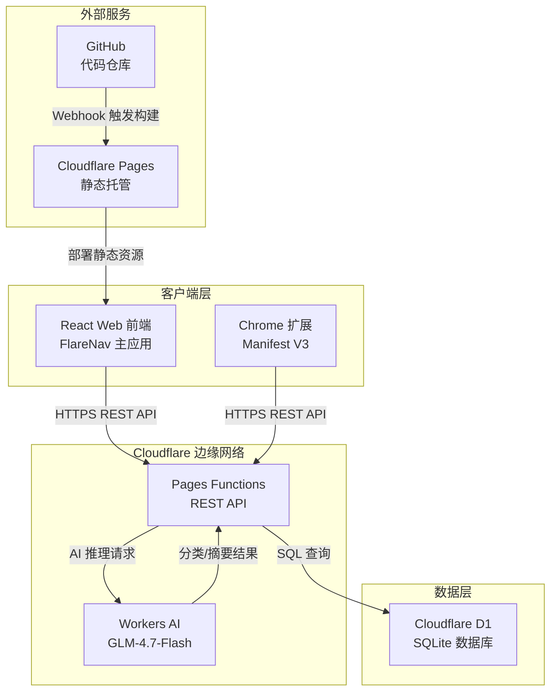

# FlareNav - 轻量级自托管个人导航与书签系统


基于 **Cloudflare Pages + Cloudflare D1 (SQLite)** 全栈 Serverless 架构的个人导航与书签系统，配套 **Chrome 浏览器收藏扩展 (Manifest V3)** 与 AI 智能分类能力。

---

## ✨ 核心特性

- ⚡ **100% Serverless 架构**：依托 Cloudflare 全球边缘网络，前端 Pages 托管，后端 Pages Functions 提供 REST API，数据持久化在 Cloudflare D1 (分布式 SQLite) 上，**零服务器运维成本，终身免费额度充足**。
- 🧩 **配套 Chrome 浏览器收藏插件 (Manifest V3)**：
    - 一键收录当前网页，自动抓取 Favicon、网页标题与页面摘要；
    - 插件弹窗内支持即时搜索与书签直达；
    - 支持右键菜单一键推送到 FlareNav；
    - AI 智能推断分类与自动填充摘要。
- 🤖 **AI 智能分类与语义搜索**：基于 Cloudflare Workers AI (GLM-4.7-Flash)，自动识别网站分类、生成功能摘要与关键词标签，支持自然语言语义搜索书签库。
- 🔍 **多引擎聚合检索**：内置站内书签秒级检索 + Google / Bing / GitHub / DuckDuckGo / 百度 / B站 / AI 语义搜索快捷切换。
- 📱 **多布局响应式体验**：支持 Bento 磁贴、标准网格、紧凑列表 3 种布局切换，自适应移动端与桌面端，超宽屏可达 6 列展示。
- 🎨 **主题系统**：暗黑、明亮、OLED 纯黑、Cyber 极客主题无缝切换。
- 📥 **数据导入与导出**：支持 Chrome / Edge / Firefox 标准 Netscape HTML 书签批量导入导出，以及 JSON / D1 SQL Dump 备份。
- 🔐 **安全管理模式**：基于 `ADMIN_SECRET_KEY` 鉴权，支持置顶推荐、分类管理、访问热度统计，可集成 Cloudflare Zero Trust 实现免密管理员识别。

---

## 🏗️ 技术架构

| 层级 | 技术栈 | 说明 |
|------|--------|------|
| 前端框架 | React 19 + TypeScript | 响应式 UI 渲染与类型安全 |
| 构建工具 | Vite 5 | 开发服务器与生产构建 |
| 样式方案 | Tailwind CSS 3 | 原子化 CSS 框架，支持深色模式 |
| 图标库 | Lucide React | 现代化 SVG 图标组件 |
| API 服务 | Cloudflare Pages Functions | 边缘计算无服务器 REST API |
| 数据库 | Cloudflare D1 (SQLite) | 分布式关系型数据库，支持 SQL 查询 |
| AI 推理 | Cloudflare Workers AI | GLM-4.7-Flash 模型，智能分类与语义搜索 |
| 浏览器扩展 | Chrome Manifest V3 | 原生 JS + CSS 实现的收藏插件 |
| 部署托管 | Cloudflare Pages | 全球 CDN 静态托管与自动部署 |
| 版本控制 | GitHub + Webhook | 代码托管与 CI/CD 自动构建 |
| 本地开发 | Express.js | 本地全栈开发与 D1 模拟服务器 |

---

## 🔄 系统架构流程



---

## 📁 目录结构

```text
├── schema.sql                 # Cloudflare D1 (SQLite) 数据库表结构定义
├── wrangler.toml              # Cloudflare Pages / D1 部署配置文件
├── functions/                 # Cloudflare Pages Functions (Edge API 路由)
│   └── api/
│       ├── [[route]].ts       # 全功能 D1 REST API 处理器
│       ├── classify.ts        # AI 智能分类接口 (POST /api/classify)
│       └── ai-search.ts       # AI 语义搜索接口 (POST /api/ai-search)
├── extension/                 # Chrome 浏览器扩展 (Manifest V3)
│   ├── manifest.json          # 扩展清单文件
│   ├── popup.html / popup.js  # 插件弹窗 UI 与交互逻辑
│   ├── options.html / .js     # 插件服务器与密钥配置页
│   ├── background.js          # 后台 Service Worker 与右键菜单
│   └── README.md              # 插件加载说明
├── public/extension/          # 最新版扩展源码（供 ZIP 打包下载）
│   ├── manifest.json
│   ├── popup.html / .css / .js
│   ├── options.html / .js
│   └── background.js
├── src/                       # 前端 React + Tailwind CSS 源码
│   ├── components/            # UI 组件库 (导航栏, 侧边栏, 磁贴网格, 模态框等)
│   ├── services/              # API 与 D1 同步服务
│   ├── types.ts               # TypeScript 类型定义
│   └── App.tsx                # 应用核心入口
└── server.ts                  # 本地全栈开发与 D1 模拟服务器 (Express)
```

---

## 🚀 部署到 Cloudflare Pages (只需 3 分钟)

### 第一步：创建 Cloudflare D1 数据库

确保已安装 Node.js，在终端执行：

```shell
# 登录 Cloudflare 账号
npx wrangler login

# 创建 D1 数据库
npx wrangler d1 create flarenav_db
```

### 第二步：初始化 SQLite 数据表

```shell
npx wrangler d1 execute flarenav_db --file=./schema.sql --remote
```

### 第三步：推送到 GitHub 并连接 Cloudflare Pages

1. 将当前项目推送到您的 GitHub 仓库；
2. 登录 [Cloudflare Dashboard](https://dash.cloudflare.com/)，进入 **Workers & Pages > Create application > Pages > Connect to Git**；
3. 选择刚才推送的仓库，配置构建参数：
    - **Framework preset**: None
    - **Build command**: `npm run build`
    - **Build output directory**: `dist`
4. 进入 Pages 项目详情页：**Settings > Functions > D1 database bindings**，添加绑定：
    - **Variable name**: `DB`
    - **D1 database**: 选择 `flarenav_db`
    
    > 💡 **提示**：直接在控制台绑定 D1 即可，无需在 `wrangler.toml` 中填写占位 ID，可避免 `Error 8000022: Invalid database UUID` 报错。
    
5. （可选）在 **Settings > Environment variables** 中添加 `ADMIN_SECRET_KEY` 作为您的自定义管理密钥（默认值为 `admin123`）。

### 第四步：启用 AI 智能功能（可选）

1. 进入 Pages 项目 **Settings > Functions > Workers AI bindings**；
2. 点击 **Add binding**，添加：
    - **Variable name**: `AI`
3. 保存后重新部署即可启用 AI 智能分类与语义搜索功能。

> 💡 **提示**：未配置 AI 绑定时，系统会自动降级至内置规则分类，不影响基础使用。Cloudflare Workers AI 每天提供 10,000 免费神经元额度，约可支撑 2,000-3,000 次分类请求。

---

## 🔌 安装配套 Chrome 插件

### 方法一：加载已解压的扩展程序（推荐）

1. 打开 Chrome 浏览器，在地址栏输入 `chrome://extensions/` 并回车；
2. 打开右上角的 **「开发者模式」 (Developer mode)**；
3. 点击左上角 **「加载已解压的扩展程序」 (Load unpacked)**；
4. 选择本项目根目录下的 `extension/` 文件夹；
5. 加载完成后，点击插件图标进入设置，填入您的 Cloudflare Pages 线上地址与管理密钥。

### 方法二：一键配置同步

1. 在 FlareNav 网页端点击顶部 **「🧩 插件」** 按钮；
2. 复制生成的 **专属同步配置码**；
3. 打开 Chrome 扩展的设置页面，粘贴配置码并点击 **「⚡一键解析」**；
4. 插件将自动填充服务器地址和管理员令牌并完成连接测试。

---

## ❓ 常见问题

<details>
<summary>Q: 部署时报错 <code>Invalid database UUID</code> 怎么办？</summary>

**A:** 删除 `wrangler.toml` 中的数据库配置（或注释掉 `[[d1_databases]]` 部分），直接在 Cloudflare Pages 控制台绑定 D1 数据库即可。绑定后记得重新部署。
</details>

<details>
<summary>Q: AI 分类功能不生效？</summary>

**A:** 确保已在 Pages 项目中添加 Workers AI 绑定（变量名为 `AI`），并重新部署。如果未配置，系统会自动降级至内置规则分类。
</details>

<details>
<summary>Q: 管理密钥输入正确但仍提示错误？</summary>

**A:** 检查环境变量 `ADMIN_SECRET_KEY` 是否包含首尾空格或引号。系统会自动清洗这些字符，但如果问题持续，请尝试重新部署。
</details>

<details>
<summary>Q: 如何备份我的书签数据？</summary>

**A:** 在网页端点击顶部 **「⚙️ 工具与设置」** → **「数据导入/导出」**，支持导出为 JSON、Netscape HTML 或 D1 SQL Dump 格式。
</details>

<details>
<summary>Q: 如何实现公网安全访问？</summary>

**A:** 推荐使用 Cloudflare Zero Trust（免费支持 50 个用户）。在网页端点击 **「⚙️ 工具与设置」** → **「🛡️ Cloudflare 零信任」** 查看详细配置指南。配置后系统会自动识别通过验证的管理员邮箱。
</details>

---

## 🔒 安全说明

- **管理员鉴权**：所有写操作（添加/编辑/删除）均需验证 `ADMIN_SECRET_KEY`
- **只读访问**：未鉴权用户仅可查看公开书签（管理员可标记特定书签为"仅管理员可见"）
- **Zero Trust 集成**：支持 Cloudflare Access，实现企业级身份验证
- **API 限流**：Cloudflare 边缘网络自动提供基础 DDoS 防护

---

## 📄 许可证

本项目采用 MIT 许可证。详情请参阅 [LICENSE](./LICENSE) 文件。

---

## 🙏 致谢

- [Cloudflare](https://www.cloudflare.com/) - 提供 Pages、D1、Workers AI 等免费服务
- [Google AI Studio](https://aistudio.google.com/) - 提供一站式开发，最新的模型等免费服务
